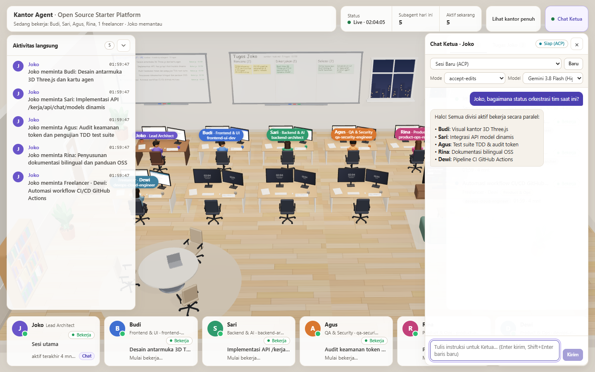

# Kantor Agent untuk Google Antigravity

[English](README.md) | **Bahasa Indonesia**



Pemantau kantor 3D *real-time* isometrik (Three.js r170) dan jembatan **Chat Ketua interaktif** (`agy acp --stdio`) untuk **Google Antigravity** (2.0, IDE, dan CLI). Berjalan **native di Windows** (serta macOS dan Linux) menggunakan satu runtime **Node.js `>= 22.5`** tanpa WSL, tanpa `bash`, dan tanpa dependensi `npm` eksternal.

> Adaptasi Antigravity ini di-port dari karya asli [humaedihume/kantor-agent](https://github.com/humaedihume/kantor-agent) di bawah **MIT License** (lihat [LICENSE](LICENSE) dan [THIRD_PARTY_NOTICES.md](THIRD_PARTY_NOTICES.md)). Konsep visual kantor 3D terinspirasi dari Schwarz.

---

## Fitur Utama

1. **Kantor 3D Real-Time Lintas Surface Antigravity:**
   - Memindai `conversation_summaries.db` secara *read-only* (`node:sqlite`) lintas root surface (`~/.gemini/{antigravity,antigravity-ide,antigravity-cli}`) dan membaca transkrip serta artifact secara inkremental dengan redaksi kredensial otomatis.
   - Panel **Aktivitas langsung**, tab **Riwayat**, papan **Tugas Ketua** (`task.md`), dan tab **Artifact** lengkap dengan modal pratinjau aman.
2. **Mode Spesialis Ketat untuk 4 Divisi Tim IT:**
   - **Ketua · Joko (`Lead Architect`)** mengorkestrasi tugas ke 4 meja spesialis tetap sesuai skill Antigravity terpasang:
     - **Budi (`Frontend & UI`)**: `frontend-ui-dev`
     - **Sari (`Backend & AI`)**: `backend-architect`
     - **Agus (`QA & Security`)**: `qa-security-engineer` / `browser`
     - **Rina (`Product & Ops`)**: `product-ops-researcher` / `research`
   - Tugas paralel di divisi yang sedang bekerja/cooldown atau tugas tak terklasifikasi otomatis dialihkan ke **Freelancer** (`Yoga`, `Dewi`, dll.) di meja cadangan (tidak pernah meminjam meja divisi lain).
3. **Chat Browser Langsung ke Ketua dengan Model Dinamis:**
   - Laci chat lipat (`C`) langsung ke Ketua via `agy acp --stdio`.
   - Pemilih model dinamis terintegrasi otomatis dari daftar `agy models` dengan input cadangan model kustom.
   - Pilihan sesi CLI atau sesi baru ACP, mode kerja (`accept-edits`, `plan`, `auto`), streaming SSE responsif, tombol batal, dan **Kartu Izin interaktif** dengan batas waktu aman 120 detik.
4. **Keamanan Lokal-Pertama:**
   - Default server hanya mengikat `127.0.0.1` dengan loopback terotentikasi otomatis.
   - Header keamanan ketat, CSP nonce per respons, validasi `Host` dan `Origin`, redaksi rahasia otomatis, serta `chat-token` 32-byte entropi tinggi (`0o600`) wajib untuk akses non-loopback, LAN (`--bind 0.0.0.0`), atau tunnel publik.

---

## Prasyarat

- **Node.js `>= 22.5`** (menggunakan modul bawaan `node:sqlite`, `node:http`, `node:crypto`, dan `node:child_process`).
- **Google Antigravity (`agy` CLI)** terpasang di `PATH` (atau set `KANTOR_AGY_BIN`) untuk fitur Chat ACP Ketua.
- *(Opsional)* **`cloudflared`** untuk membuka URL publik sementara (`winget install Cloudflare.cloudflared` di Windows).

---

## Pemasangan & Mulai Cepat

### 1. Pasang Plugin Antigravity

Klona repositori dan pasang plugin menggunakan Antigravity CLI:

```powershell
git clone https://github.com/23Barajapu/kantor-agent.git
agy plugin install ./kantor-agent
```

### 2. Periksa Lingkungan

```powershell
node skills/kantor-agent/runtime/bin/kantor.mjs detect
```

### 3. Pasang 4 Templat Subagent Spesialis (Opsional, Idempoten)

Menyalin 4 definisi agen (`frontend-ui-dev.md`, `backend-architect.md`, `qa-security-engineer.md`, `product-ops-researcher.md`) ke `~/.gemini/config/agents/` tanpa menimpa perubahan pengguna yang sudah ada:

```powershell
node skills/kantor-agent/runtime/bin/kantor.mjs setup-team
# Gunakan --force bila ingin menimpa templat yang sudah ada:
node skills/kantor-agent/runtime/bin/kantor.mjs setup-team --force
```

### 4. Jalankan Kantor Agent untuk Proyek Anda

```powershell
node skills/kantor-agent/runtime/bin/kantor.mjs start --project C:\path\ke\proyek
```

Buka URL yang dicetak di browser (default `http://127.0.0.1:8788/kerja`). Tekan **`C`** untuk membuka **Chat Ketua** atau **`H`** untuk tampilan kantor penuh.

---

## Referensi Perintah CLI (`kantor.mjs`)

| Perintah | Deskripsi |
|---|---|
| `detect [--json]` | Memeriksa versi Node.js `>= 22.5`, `node:sqlite`, biner `agy` dan `cloudflared`, root DB Antigravity, serta status 4 templat Tim IT. |
| `setup-team [--force]` | Memasang 4 templat subagent spesialis ke `~/.gemini/config/agents/`. |
| `start` | Menjalankan `serve.mjs` di latar belakang pada port tersedia (`8788..8808`) dan menyimpan `server.json` di storage proyek. |
| `stop` | Menghentikan server dan tunnel aktif dengan bersih serta menghapus `server.json`. |
| `restart` | Menjalankan `stop` lalu `start`. |
| `status [--json]` | Menampilkan status server, PID, port, subagent aktif, dan `public_url`. |
| `url` | Mencetak URL lokal (atau `public_url` bila tunnel aktif). |
| `token` | Mencetak `chat-token` rahasia dari `<storageDir>/chat-token`. |
| `tunnel` / `tunnel-stop` | Membuka atau menutup tunnel publik sementara via `cloudflared` (tidak mencetak token mentah ke terminal). |
| `autostart` | Hook `SessionStart` opt-in (hanya aktif bila `autostart: true` atau `KANTOR_AUTOSTART=1`). |

Flag yang didukung: `--project <dir>`, `--storage <dir>`, `--bind <ip>`, `--port <n>`, `--sandbox`, `--force`, `--quiet`, `--json`.

### Autentikasi Chat Non-Loopback & Akses CLI

- **Browser (LAN / Tunnel):** Masukkan nilai dari `<storageDir>/chat-token` di formulir laci **Chat Ketua** (`POST /kerja/api/chat/auth`) untuk mendapatkan cookie sesi `HttpOnly; SameSite=Strict`.
- **Akses CLI / Skrip Non-Browser:** Kirim header `Authorization: Bearer <token>` (atau `X-Kantor-Token: <token>`) langsung pada endpoint `/kerja/api/chat/*`. Nilai token dapat diambil melalui `node skills/kantor-agent/runtime/bin/kantor.mjs token`.

---

## Matriks 4 Divisi Tim IT & Skill Antigravity

| Karakter | TypeName & Divisi | Cakupan Skill Terpasang |
|---|---|---|
| **Joko** *(Ketua)* | `Lead Architect` | Orkestrasi tim, pemeliharaan `task.md`, delegasi `invoke_subagent` |
| **Budi** *(Meja 0)* | `frontend-ui-dev` · **Frontend & UI** | `frontend-ui-engineering`, `antislop-ui`, `antislop-human`, `antislop-layoutmobile`, `emil-design-eng`, `apple-design`, `animate*`, `pick-ui-library`, `ask-sonner`, `break-ui`, `a11y-debugging`, `mobile-native`, `figma-*`, `canva-*`, `remotion-*`, `generative_ui` |
| **Sari** *(Meja 1)* | `backend-architect` · **Backend & AI** | `api-and-interface-design`, `codebase-design`, `domain-modeling`, `design-patterns`, `improve-codebase-architecture`, `setup-ts-deep-modules`, `constraint-driven-development`, `incremental-implementation`, `lean-build`, `implement*`, `safe-refactor`, `code-simplification`, `migration`, `observability-and-instrumentation`, `performance*`, `write-swift`, `gemini-api-dev`, `gemini-live-api-dev`, `gemini-omni-flash-api`, `google-antigravity-sdk` |
| **Agus** *(Meja 2)* | `qa-security-engineer` *(+ `browser`)* · **QA & Security** | `tdd`, `test-driven-development`, `tdd-rust`, `rtk-tdd`, `systematic-debugging`, `debugging-and-error-recovery`, `diagnosing-bugs`, `investigate-first`, `browser-testing-with-devtools`, `chrome-devtools*`, `cookie-debugging`, `memory-leak-debugging`, `debug-optimize-lcp`, `troubleshooting`, `security-audit`, `security-and-hardening`, `security-guardian`, `code-review*`, `pr-review`, `ponytail-review`, `ponytail-audit`, `quality-control`, `verification-before-completion`, `verify-and-stop`, `surgical-patch`, `doubt-driven-development`, `migrate-to-shoehorn` |
| **Rina** *(Meja 3)* | `product-ops-researcher` *(+ `research`)* · **Product & Ops** | `brainstorming`, `spec-driven-development`, `planning-and-task-breakdown`, `writing-plans`, `idea-refine`, `interview-me`, `grill-me`, `grilling`, `research`, `source-driven-development`, `graphify`, `documentation-and-adrs`, `writing-for-agents`, `antislop-copywriting`, `bahasa-indonesia`, `ci-cd-and-automation`, `git-workflow-and-versioning`, `git-guardrails-claude-code`, `setup-pre-commit`, `finishing-a-development-branch`, `ship`, `shipping-and-launch`, `pr`, `pr-triage`, `issue-triage`, `repo-recap`, `gdocs`, `gdrive`, `gsheets`, `gslides`, `automation`, `wizard` |

---

## Konfigurasi Proyek & Variabel Lingkungan

Penimpaan opsi per proyek dapat diletakkan di `<project>/.agents/kantor-agent.json`:

```json
{
  "title": "Proyek Saya",
  "port": 8788,
  "bind": "127.0.0.1",
  "autostart": false,
  "names": {
    "ketua": "Joko",
    "team": ["Budi", "Sari", "Agus", "Rina"],
    "freelancers": ["Yoga", "Dewi", "Rudi", "Maya"]
  },
  "chat": {
    "enabled": true,
    "default_mode": "accept-edits",
    "default_model": null,
    "sandbox": false
  }
}
```

Variabel lingkungan yang didukung:
- `KANTOR_STORAGE`: Menimpa folder state/token/log (default `~/.cache/kantor-agent/<slug>-<hash12>`).
- `KANTOR_BIND`: Menimpa alamat bind HTTP (prioritas di bawah flag `--bind`).
- `KANTOR_SANDBOX`: `1` atau `true` untuk menyalakan `--sandbox` ACP (prioritas di bawah `--sandbox`).
- `KANTOR_AGY_BIN`: Path khusus ke biner `agy`.
- `KANTOR_AUTOSTART`: `1` atau `true` untuk mengaktifkan `autostart` hook.
- `KANTOR_ALLOWED_HOSTS`: Daftar host tambahan dipisah koma yang diizinkan pada header `Host`.
- `ANTIGRAVITY_HOME`: Mengarahkan pemindaian DB dan brain ke direktori tertentu (berguna untuk pengujian).
- `ANTIGRAVITY_CONFIG_DIR`: Direktori konfigurasi target bagi `setup-team` (default `~/.gemini/config`).

---

## Pengujian & Validasi Plugin

```powershell
# Jalankan seluruh unit & integration test
npm test

# Periksa kesiapan lingkungan
npm run detect

# Validasi struktur plugin Antigravity secara strict
agy plugin validate --strict .
```

---

## Kredit & Lisensi

- Dirancang dan di-port untuk Google Antigravity dari karya asli [humaedihume/kantor-agent](https://github.com/humaedihume/kantor-agent) (Copyright (c) 2026 humaedihume, **MIT License**).
- Konsep visual 3D kantor terinspirasi dari Schwarz.
- Memaketkan **three.js r170** (Copyright (c) 2010-2024 three.js authors, **MIT License**) di `skills/kantor-agent/runtime/public/assets/vendor/three/`.
- Dilindungi di bawah [MIT License](LICENSE). Lihat [THIRD_PARTY_NOTICES.md](THIRD_PARTY_NOTICES.md) untuk pemberitahuan lengkap.
