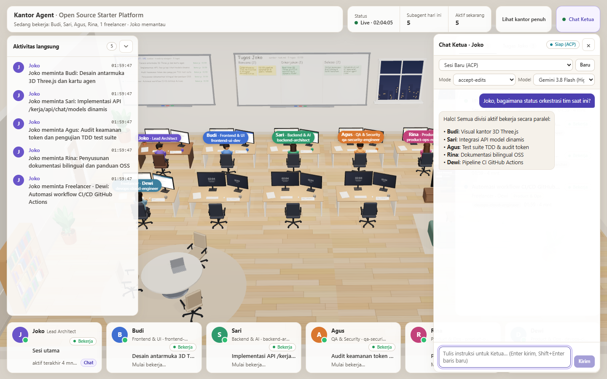

# Kantor Agent for Google Antigravity

**English** | [Bahasa Indonesia](README.id.md)



Real-time 3D isometric office monitor (Three.js r170) and **interactive Ketua ACP chat bridge** (`agy acp --stdio`) for **Google Antigravity** (2.0, IDE, and CLI). Runs **natively on Windows** (as well as macOS and Linux) powered by a single **Node.js `>= 22.5`** runtime with zero WSL, zero bash scripts, and zero external npm dependencies.

> This Antigravity port is adapted from [humaedihume/kantor-agent](https://github.com/humaedihume/kantor-agent) under the **MIT License** (see [LICENSE](LICENSE) and [THIRD_PARTY_NOTICES.md](THIRD_PARTY_NOTICES.md)). Original 3D office concept by Schwarz.

---

## Core Features

1. **Real-Time 3D Office Across Antigravity Surfaces:**
   - Scans `conversation_summaries.db` in read-only mode (`node:sqlite`) across all surface roots (`~/.gemini/{antigravity,antigravity-ide,antigravity-cli}`) and reads transcripts and artifacts incrementally with automatic credential redaction.
   - Real-time **Live Activity** feed, **History** runs tab, **Ketua Task Board** (`task.md`), and **Artifacts** tab with secure preview modal.
2. **Strict Specialist Mode for 4 IT Team Divisions:**
   - **Lead Architect · Joko (Ketua)** orchestrates work to 4 fixed specialist desks matching installed Antigravity agent skills:
     - **Budi (Frontend & UI)**: `frontend-ui-dev`
     - **Sari (Backend & AI)**: `backend-architect`
     - **Agus (QA & Security)**: `qa-security-engineer` / `browser`
     - **Rina (Product & Ops)**: `product-ops-researcher` / `research`
   - Concurrent tasks in an already working division or unclassified tasks automatically route to **Freelancers** (`Yoga`, `Dewi`, etc.) at backup desks (never borrowing desks from other divisions).
3. **Interactive Browser ACP Chat with Dynamic Models:**
   - Collapsible chat drawer (`C` hotkey) connecting directly to Ketua via `agy acp --stdio`.
   - Dynamic model selector automatically populated from `agy models` with custom model ID fallback input.
   - Session switcher (new ACP session or resume existing CLI session), execution modes (`accept-edits`, `plan`, `auto`), SSE streaming responses, cancellation, and interactive permission cards with 120-second safety timeout.
4. **Local-First Security:**
   - Binds to `127.0.0.1` by default with local loopback auto-authorization.
   - Strict security headers, per-response Content Security Policy (CSP) nonce, `Host` and `Origin` validation, automatic credential redaction, and a high-entropy 32-byte `chat-token` (`0o600` permissions) required for LAN (`--bind 0.0.0.0`) or public tunnel access.

---

## Prerequisites

- **Node.js `>= 22.5`** (utilizing native `node:sqlite`, `node:http`, `node:crypto`, and `node:child_process`).
- **Google Antigravity (`agy` CLI)** installed in `PATH` (or configured via `KANTOR_AGY_BIN`).
- *(Optional)* **`cloudflared`** for temporary public tunneling (`winget install Cloudflare.cloudflared` on Windows).

---

## Installation & Quick Start

### 1. Install Antigravity Plugin

Clone this repository and install it directly via the Antigravity CLI:

```powershell
git clone https://github.com/23Barajapu/kantor-agent.git
agy plugin install ./kantor-agent
```

### 2. Verify Your Environment

```powershell
node skills/kantor-agent/runtime/bin/kantor.mjs detect
```

### 3. Install 4 IT Specialist Subagent Templates (Optional, Idempotent)

Copies the 4 specialist agent templates (`frontend-ui-dev.md`, `backend-architect.md`, `qa-security-engineer.md`, `product-ops-researcher.md`) into `~/.gemini/config/agents/` without overwriting existing user modifications:

```powershell
node skills/kantor-agent/runtime/bin/kantor.mjs setup-team
# Use --force to overwrite existing templates:
node skills/kantor-agent/runtime/bin/kantor.mjs setup-team --force
```

### 4. Launch Kantor Agent for Your Project

```powershell
node skills/kantor-agent/runtime/bin/kantor.mjs start --project C:\path\to\your\project
```

Open the printed URL in your browser (default `http://127.0.0.1:8788/kerja`). Press **`C`** to toggle the **Ketua Chat Drawer** or **`H`** for full office view.

---

## CLI Command Reference (`kantor.mjs`)

| Command | Description |
|---|---|
| `detect [--json]` | Verifies Node.js `>= 22.5`, `node:sqlite`, `agy` and `cloudflared` binaries, Antigravity DB roots, and 4 IT Team templates status. |
| `setup-team [--force]` | Copies the 4 specialist subagent templates into `~/.gemini/config/agents/`. |
| `start` | Launches `serve.mjs` detached in background on an available port (`8788..8808`) and records `server.json` in storage. |
| `stop` | Gracefully shuts down active server and associated tunnel processes and removes `server.json`. |
| `restart` | Runs `stop` followed by `start`. |
| `status [--json]` | Displays running server PID, port, active subagent count, and public tunnel URL if active. |
| `url` | Prints local URL (or public tunnel URL when active). |
| `token` | Displays the 32-byte secret `chat-token` from `<storageDir>/chat-token`. |
| `tunnel` / `tunnel-stop` | Opens or terminates a temporary HTTPS public tunnel via `cloudflared` (never prints raw token to stdout). |
| `autostart` | Opt-in `SessionStart` hook (triggered when `autostart: true` or `KANTOR_AUTOSTART=1`). |

Supported CLI flags: `--project <dir>`, `--storage <dir>`, `--bind <ip>`, `--port <n>`, `--sandbox`, `--force`, `--quiet`, `--json`.

### Non-Loopback & LAN Authentication

- **Web Browser (LAN / Tunnel):** Enter the token from `<storageDir>/chat-token` into the **Chat Ketua** authorization card (`POST /kerja/api/chat/auth`) to receive an `HttpOnly; SameSite=Strict` session cookie.
- **CLI / Script Access:** Pass `Authorization: Bearer <token>` or `X-Kantor-Token: <token>` header with requests to `/kerja/api/chat/*`. Tokens can be retrieved with `node skills/kantor-agent/runtime/bin/kantor.mjs token`.

---

## IT Divisions & Installed Skills Matrix

| Specialist | TypeName & Division | Installed Antigravity Skills Scope |
|---|---|---|
| **Joko** *(Ketua)* | `Lead Architect` | Team orchestration, `task.md` management, subagent delegation via `invoke_subagent` |
| **Budi** *(Desk 0)* | `frontend-ui-dev` · **Frontend & UI** | `frontend-ui-engineering`, `antislop-ui`, `antislop-human`, `antislop-layoutmobile`, `emil-design-eng`, `apple-design`, `animate*`, `pick-ui-library`, `ask-sonner`, `break-ui`, `a11y-debugging`, `mobile-native`, `figma-*`, `canva-*`, `remotion-*`, `generative_ui` |
| **Sari** *(Desk 1)* | `backend-architect` · **Backend & AI** | `api-and-interface-design`, `codebase-design`, `domain-modeling`, `design-patterns`, `improve-codebase-architecture`, `setup-ts-deep-modules`, `constraint-driven-development`, `incremental-implementation`, `lean-build`, `implement*`, `safe-refactor`, `code-simplification`, `migration`, `observability-and-instrumentation`, `performance*`, `write-swift`, `gemini-api-dev`, `gemini-live-api-dev`, `gemini-omni-flash-api`, `google-antigravity-sdk` |
| **Agus** *(Desk 2)* | `qa-security-engineer` *(+ `browser`)* · **QA & Security** | `tdd`, `test-driven-development`, `tdd-rust`, `rtk-tdd`, `systematic-debugging`, `debugging-and-error-recovery`, `diagnosing-bugs`, `investigate-first`, `browser-testing-with-devtools`, `chrome-devtools*`, `cookie-debugging`, `memory-leak-debugging`, `debug-optimize-lcp`, `troubleshooting`, `security-audit`, `security-and-hardening`, `security-guardian`, `code-review*`, `pr-review`, `ponytail-review`, `ponytail-audit`, `quality-control`, `verification-before-completion`, `verify-and-stop`, `surgical-patch`, `doubt-driven-development`, `migrate-to-shoehorn` |
| **Rina** *(Desk 3)* | `product-ops-researcher` *(+ `research`)* · **Product & Ops** | `brainstorming`, `spec-driven-development`, `planning-and-task-breakdown`, `writing-plans`, `idea-refine`, `interview-me`, `grill-me`, `grilling`, `research`, `source-driven-development`, `graphify`, `documentation-and-adrs`, `writing-for-agents`, `antislop-copywriting`, `bahasa-indonesia`, `ci-cd-and-automation`, `git-workflow-and-versioning`, `git-guardrails-claude-code`, `setup-pre-commit`, `finishing-a-development-branch`, `ship`, `shipping-and-launch`, `pr`, `pr-triage`, `issue-triage`, `repo-recap`, `gdocs`, `gdrive`, `gsheets`, `gslides`, `automation`, `wizard` |

---

## Configuration & Environment Variables

Optional project-level configuration overrides can be placed in `<project>/.agents/kantor-agent.json`:

```json
{
  "title": "My Project",
  "port": 8788,
  "bind": "127.0.0.1",
  "autostart": false,
  "names": {
    "ketua": "Joko",
    "team": ["Budi", "Sari", "Agus", "Rina"],
    "freelancers": ["Yoga", "Dewi", "Rudi", "Maya"]
  },
  "chat": {
    "enabled": true,
    "default_mode": "accept-edits",
    "default_model": null,
    "sandbox": false
  }
}
```

Supported environment variables:
- `KANTOR_STORAGE`: Custom storage directory for state, tokens, and logs (default `~/.cache/kantor-agent/<slug>-<hash12>`).
- `KANTOR_BIND`: Overrides default bind IP address.
- `KANTOR_SANDBOX`: `1` or `true` to enable ACP `--sandbox` mode.
- `KANTOR_AGY_BIN`: Absolute or PATH-relative path to custom `agy` binary.
- `KANTOR_AUTOSTART`: `1` or `true` to activate `autostart` session hook.
- `KANTOR_ALLOWED_HOSTS`: Comma-separated list of additional permitted HTTP `Host` header values.
- `ANTIGRAVITY_HOME`: Points conversation database and brain scanning to a specific directory (useful for testing).
- `ANTIGRAVITY_CONFIG_DIR`: Target configuration directory for `setup-team` (default `~/.gemini/config`).

---

## Testing & Strict Plugin Validation

```powershell
# Run all unit and integration tests (100% pass)
npm test

# Run environment detector
npm run detect

# Strict Antigravity plugin manifest validation
agy plugin validate --strict .
```

---

## Credits & License

- Adapted and ported for Google Antigravity from the original work by [humaedihume/kantor-agent](https://github.com/humaedihume/kantor-agent) (Copyright (c) 2026 humaedihume, **MIT License**).
- 3D office concept inspired by Schwarz.
- Bundles **three.js r170** (Copyright (c) 2010-2024 three.js authors, **MIT License**) in `skills/kantor-agent/runtime/public/assets/vendor/three/`.
- Licensed under the [MIT License](LICENSE). See [THIRD_PARTY_NOTICES.md](THIRD_PARTY_NOTICES.md) for full notices.
